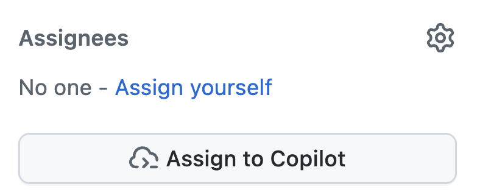

| [← 上一课：自定义说明][previous-lesson] |
|:--|

几乎所有组织都会遇到技术债务，例如尚未解决的安全问题、需要更新的旧代码，或因缺少时间而长期搁置的功能请求。GitHub Copilot cloud agent 能够自主执行更新代码、添加功能等任务。完成工作后，它会创建草稿 PR，供开发者检查。这样可以将繁琐任务委托出去，加快开发流程，让开发者专注于更重要的工作。

你将使用 Copilot cloud agent 探索以下内容：

- 自定义代码生成环境。
- 确保安全地执行操作。
- 明确限定议题范围的重要性。
- 将议题分配给 Copilot。

## 场景

Tailspin Toys 有一些技术债务需要处理。最初受聘开发网站的承包商没有留下完善的文档，实际上，代码中完全缺少文档。团队希望首先为应用中所有导出的函数添加 TSDoc 文档注释。

此外，设计团队准备改进游戏发现体验。他们希望每款游戏的详情页都能显示相关游戏，也就是同一类别中的其他游戏，以便用户继续浏览。团队暂时不需要完善的实现，只希望先有一个版本用于 UX 验收测试。目前这项工作尚未完成，但优先级低于其他议题。

这些任务都可能因优先级调整而被搁置，非常适合交给 Copilot cloud agent。它可以在后台异步处理，开发者则继续完成其他任务，之后再回来检查 Copilot 的工作。

## 了解 GitHub Copilot cloud agent

[GitHub Copilot cloud agent](https://docs.github.com/copilot/concepts/agents/cloud-agent/about-cloud-agent#overview-of-copilot-cloud-agent-formerly-copilot-coding-agent) 可以像人类开发者一样在后台执行任务。与人类协作者类似，分配工作有多种方式，包括[将 GitHub 议题分配给 Copilot](https://docs.github.com/copilot/how-tos/use-copilot-agents/cloud-agent/start-copilot-sessions)。分配后，Copilot 会创建一个草稿拉取请求来跟踪进度，设置环境，并开始处理任务。无论任务是否完成，你都可以查看 Copilot 会话。解决方案准备好供你检查时，它会在拉取请求中提及你！

## 明确限定任务范围的重要性

GitHub Copilot 没有魔法，不能让你跳过思考。即使看似简单的操作，深入分析后也会发现复杂性，因此[为 Copilot cloud agent 明确限定任务范围][cloud-agent-best-practices]很重要。请把它当作 AI 结对编程伙伴：分阶段开展工作、学习、试验并不断调整。引入生成式 AI 并不会改变软件开发的基本原则。

## 此存储库中的自定义说明

前面的练习介绍了自定义说明及其如何指导 Copilot。如果你已经完成自定义说明的实践，就见过 `.github/copilot-instructions.md` 的实际效果；如果还没有，现在可以快速查看一下。将任务分配给 Copilot cloud agent 之前，先只读浏览此存储库中已有的说明文件，以便之后观察它们的影响。

在 GitHub 网页界面或已启动的 codespace 中打开以下文件：

- `.github/copilot-instructions.md`：查看 **Code standards** 章节，特别是 TypeScript 约定和 TSDoc 文档注释方面的要求。
- `.github/instructions/unit-tests.instructions.md`：注意 `applyTo` frontmatter，它将这些说明应用于 `**/*.test.ts` 文件。

下一节将 `Code lacks documentation` 议题分配给 cloud agent 时，请留意生成的拉取请求中是否遵循了 TSDoc 文档注释、TypeScript 约定和文件注释标题。稍后的练习中会再次介绍这些内容。

## 为 Copilot cloud agent 设置开发环境

无论由谁编写代码，通常都需要特定环境，并运行一些设置脚本，以确保环境处于良好状态。将任务分配给 Copilot 时也是如此，它会像软件工程师一样执行任务。

Cloud agent 使用 [GitHub Actions][github-actions] 环境执行工作。你可以创建[专用设置工作流][setup-workflow]，并将其配置在 `.github/workflows/copilot-setup-steps.yml` 中，让它在 Copilot 开始工作前运行，从而为 Copilot 提供所需的开发工具和依赖项。此设置已预先配置好，以便顺利完成实验并学习相关内容。它会为单个 Astro 应用安装 Node.js、项目依赖项、端到端测试所需的浏览器二进制文件，以及经过迁移和填充数据的 SQLite 数据库：

```yaml
name: "Copilot Setup Steps"

# 允许你从存储库的“Actions”选项卡测试设置步骤
on: workflow_dispatch

env:
  ASTRO_TELEMETRY_DISABLED: "1"

jobs:
  copilot-setup-steps:
    runs-on: ubuntu-latest
    # 权限应限制为步骤所需的最低级别。Copilot 会使用自己的令牌执行操作。
    permissions:
      # 如果要在设置步骤中克隆存储库（例如安装依赖项），需要 contents: read 权限。如果设置步骤中不克隆存储库，Copilot 会在步骤完成后自动克隆。
      contents: read
    steps:
      - name: Checkout code
        uses: actions/checkout@v5

      # 前端/应用设置 - Node.js（整个应用现为 Astro + Drizzle/libSQL）
      - name: Set up Node.js
        uses: actions/setup-node@v6
        with:
          node-version: "lts/*"
          cache: "npm"
          cache-dependency-path: "./package-lock.json"

      - name: Install JavaScript dependencies
        run: npm ci

      - name: Install Playwright browsers
        run: npx playwright install --with-deps chromium

      # 迁移并填充本地 SQLite 数据库，以便构建和测试有数据可用。
      - name: Set up the database
        run: npm run db:setup
```

它看起来和其他 GitHub 工作流文件一样，但有几个要点：

- 它包含一个名为 `copilot-setup-steps` 的作业。Copilot 开始处理拉取请求之前，GitHub Actions 会运行此作业。
- 注意 `workflow_dispatch` 触发器，它允许你从存储库的 **Actions** 选项卡手动运行工作流。这样可以在等待 Copilot 运行工作流之前，先验证它是否正常。

## 添加文档

大家都知道文档很重要，但大多数项目的文档要么过时，要么完全缺失。这类技术债务往往长期得不到处理，会降低工作效率，也让代码库维护和新成员加入变得更加困难。幸运的是，Copilot 很擅长编写文档，因此这是交给 Copilot cloud agent 的理想议题。它会在后台生成所需文档，后续练习中再回来检查。

1. 在新的浏览器选项卡中打开 github.com 上的存储库。
2. 选择 **Issues** 选项卡。
3. 选择 **New issue** 打开新议题对话框。
4. 选择 **Blank issue** 创建空白议题。
5. 将 **Title** 设置为 `Code lacks documentation`。
6. 将 **Description** 设置为：

    ```plaintext
    Our organization has a requirement that functions and methods include TSDoc doc comments where helpful. Unfortunately, recent updates haven't followed this standard. We need to update the existing code to ensure doc comments are included where they clarify behavior.
    ```

7. 选择 **Create** 创建议题。
8. 在右侧选择 **Assign to Copilot** 打开分配对话框。

  

9. 选择 **Assign**。
10. 选择 **Pull Requests** 选项卡。
11. 打开新生成的拉取请求 (PR)，标题类似于 `[WIP]: Code lacks documentation`。如果列表中没有新 PR，请等待片刻并刷新浏览器窗口。
12. 几分钟后，Copilot 应该会创建待办事项列表。

> [!NOTE]
> Copilot 的待办事项列表可能需要几分钟才会出现在 PR 中。Copilot 正在创建环境（运行前面介绍的工作流）、分析项目并确定最佳处理方案。

13. 检查列表及 Copilot 准备完成的任务。
14. 向下滚动 PR 时间线，查看 Copilot 已开始处理议题的更新。
15. 选择 **View session** 按钮。

  

> [!CAUTION]
> 可能需要刷新窗口才能看到更新后的状态指示器。

16. 浏览实时会话，观察 Copilot 如何解决问题，包括探索代码、了解当前状态、暂停思考并决定合适的方案，以及编写代码。

这可能需要几分钟。Copilot cloud agent 的主要目标之一是异步执行任务，让我们可以专注于其他工作。接下来就利用这一特性：再分配一项任务给 Copilot cloud agent，同时编写代码，为应用添加功能。

## 在游戏详情页添加相关游戏

如前所述，GitHub Copilot cloud agent 的一大优势是可以拆分工作，让你专注于一组任务，同时由它处理另一组任务。为设计团队添加相关游戏可能用不了太久，但这段时间也可以用于其他工作。现在就把任务交给 Copilot cloud agent！

1. 返回 github.com 上的存储库。
2. 选择 **Issues** 选项卡。
3. 选择 **New issue** 打开新议题对话框。
4. 选择 **Blank issue** 使用空白模板。
5. 将 **Title** 设置为 `Show related games on the game details page`。
6. 将 **Description** 设置为：

    ```markdown
    We want to help people discover more games by showing related games on each game's details page. The design team wants to explore the UX and do some acceptance testing. Our requirements are:

   - Add a data-access helper in `src/lib/` that returns other games in the same category as a given game, excluding that game
   - Show a "Related games" section on the game details page that uses the helper
   - Handle the case where a game has no related games
   - There should be unit tests created for the new helper
   - Before creating the PR, ensure all tests pass
    ```

7. 选择 **Create** 创建议题。
8. 在右侧选择 **Assign to Copilot** 打开分配对话框。

  

9. 选择 **Assign**。

很快，你会在议题的第一条评论中看到一组 👀，表示 Copilot 正在处理任务！


Copilot 现在正认真处理第二项请求！Copilot cloud agent 的工作方式类似软件工程师，因此无需一直监控它；等它完成后再来检查即可。现在来创建并使用自定义智能体。

## 总结和后续步骤

本课介绍了 [GitHub Copilot cloud agent][copilot-agents]。使用 cloud agent，可以将议题分配给 Copilot，让它异步执行任务。你可以用 Copilot 处理技术债务、创建新功能，或帮助将代码迁移到其他框架。

你探索了以下内容：

- 自定义代码生成环境。
- 确保安全地执行操作。
- 明确限定议题范围的重要性。
- 将议题分配给 Copilot。

在 cloud agent 后台工作的同时，现在可以开始创建和使用自定义智能体。[Copilot cloud agent 也可以使用 MCP 服务器][cloud-agent-mcp]，并且能够读取自定义说明；我们已在之前的模块中介绍过这些内容。

## 资源

- [关于 Copilot cloud agent][copilot-agents]
- [将 GitHub 议题分配给 Copilot][assign-issue]
- [Copilot cloud agent 设置工作流最佳实践][cloud-agent-best-practices]

| [下一课：自定义智能体 →][next-lesson] |
|--:|

[previous-lesson]: ../1-custom-instructions/
[next-lesson]: ../3-custom-agents/
[cloud-agent-mcp]: https://docs.github.com/copilot/how-tos/copilot-on-github/customize-copilot/customize-cloud-agent/extend-cloud-agent-with-mcp
[assign-issue]: https://docs.github.com/copilot/how-tos/use-copilot-agents/cloud-agent/start-copilot-sessions
[setup-workflow]: https://docs.github.com/copilot/how-tos/copilot-on-github/customize-copilot/customize-cloud-agent/customize-the-agent-environment
[copilot-agents]: https://docs.github.com/copilot/concepts/agents/cloud-agent/about-cloud-agent
[cloud-agent-best-practices]: https://docs.github.com/copilot/how-tos/copilot-on-github/customize-copilot/customize-cloud-agent/customize-the-agent-environment
[github-actions]: https://docs.github.com/actions
