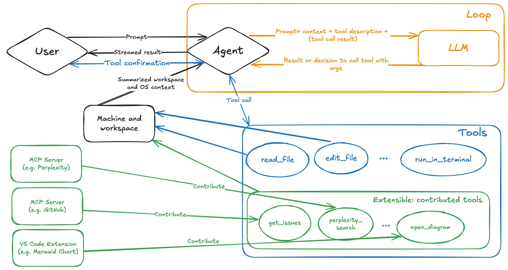

[← 上一课：Agent mode][previous-lesson] · [下一课：自定义智能体 →][next-lesson]

你刚刚使用 agent mode 构建了筛选功能。创建拉取请求前，应确认它确实能在浏览器中正常运行。无需亲自操作应用，可以连接 **Playwright MCP 服务器**，让 Copilot 操作真实浏览器测试功能，然后发布分支并创建 PR。

在本练习中，你将：

- 了解模型上下文协议 (MCP) 以及 MCP 服务器如何通过新工具扩展 Copilot。
- 向工作区添加 Playwright MCP 服务器。
- 让 Copilot 使用它在浏览器中手动测试筛选功能。
- 发布分支，并为筛选功能创建拉取请求。

## 什么是模型上下文协议 (MCP)？

当 agent mode 可以访问编辑器以外的资源时，它的能力会大幅增强。Copilot 通过模型上下文协议 (MCP) 实现这一点：这是智能体与外部工具和服务通信的标准方式。



[模型上下文协议 (MCP)](https://github.blog/ai-and-ml/llms/what-the-heck-is-mcp-and-why-is-everyone-talking-about-it/) 为 AI 智能体提供了与外部工具和服务通信的方式。借助 MCP，AI 智能体可以通过资源访问最新信息，并通过工具代表你执行操作。

这些工具和资源通过 MCP 服务器访问。MCP 服务器充当 AI 智能体与外部工具和服务之间的桥梁，负责管理 AI 智能体与外部工具（例如现有 API 或 NPM 包等本地工具）之间的通信。每台 MCP 服务器都代表 AI 智能体可访问的一组工具和资源。

以下是几种常见的 MCP 服务器：

- **[GitHub MCP Server](https://github.com/github/github-mcp-server)**：提供用于管理 GitHub 存储库的 API，让 AI 智能体可以创建新存储库、更新现有存储库，以及管理议题和拉取请求。
- **[Playwright MCP Server](https://github.com/microsoft/playwright-mcp)**：使用 Playwright 提供浏览器自动化功能，让 AI 智能体可以打开网页、填写表单和选择按钮。

还有许多其他 MCP 服务器，可以访问不同的工具和资源。GitHub 托管了 [MCP 注册表](https://github.com/mcp)，以便更容易发现并为生态系统做出贡献。

> [!CAUTION]
> 出于安全考虑，请像对待项目中的其他依赖项一样对待 MCP 服务器。使用前应仔细检查源代码、验证发布者并考虑安全影响。只使用可信的 MCP 服务器，并谨慎授予其访问敏感资源或执行敏感操作的权限。

## 检查 MCP 配置

`.vscode/mcp.json` 文件用于配置此 VS Code 工作区可用的 MCP 服务器。

1. 在 codespace 中打开 `.vscode/mcp.json`。
2. 应该能看到已为你配置的 `github` 服务器：

    ```json
    {
      "servers": {
        "github": {
          "type": "http",
          "url": "https://api.githubcopilot.com/mcp/"
        }
      }
    }
    ```

此 `github` 条目随项目模板提供，因此上一练习中 Copilot 才能读取 GitHub 积压议题。它使用[远程 GitHub MCP 服务器][remote-github-mcp-server]，无需在本地安装任何内容；VS Code 会通过 HTTP 连接服务器，并在 Copilot 首次调用其工具时使用 GitHub 进行身份验证。

## 添加 Playwright MCP 服务器

现在再添加一台服务器。[Playwright MCP 服务器][playwright-mcp-server]为 Copilot 提供可控制的浏览器，正好可以用来测试功能。

1. 在 `.vscode/mcp.json` 中添加 `playwright` 条目，与 `github` 并列，使文件内容如下：

    ```json
    {
      "servers": {
        "github": {
          "type": "http",
          "url": "https://api.githubcopilot.com/mcp/"
        },
        "playwright": {
          "command": "npx",
          "args": ["@playwright/mcp@latest", "--headless"]
        }
      }
    }
    ```

2. 保存文件。

与远程 `github` 服务器不同，`playwright` 是**本地**服务器：VS Code 会在你的计算机上运行 `npx @playwright/mcp@latest` 来启动它。`--headless` 标记表示 Playwright 会在无可见窗口的情况下运行浏览器；codespace 没有用于显示窗口的桌面，因此必须使用此模式。

> [!NOTE]
> Tailspin Toys 项目已经在端到端测试中使用 Playwright，因此通常已安装 Playwright 所需的浏览器。如果 Copilot 报告缺少浏览器，请让它运行 `npx playwright install chromium`，然后重试。

## 启动并信任服务器

VS Code 会**按需**启动 MCP 服务器：Copilot 首次需要使用服务器工具时，VS Code 会启动服务器，并询问你是否信任它。

1. 在 `.vscode/mcp.json` 中，`playwright` 条目上方会出现 **Start** 操作。选择它立即启动服务器，并确认配置正确。
2. 如果 VS Code 询问是否信任服务器，请检查配置并选择信任，以便启动服务器。

手动启动服务器是可选操作。如果跳过，VS Code 会在下一步中 Copilot 首次需要其工具时启动服务器，并提示你信任它。

## 测试筛选功能

[Playwright MCP 服务器][playwright-mcp-server]为 Copilot 提供可操作的真实浏览器。无需亲自操作应用检查成果，智能体可以打开页面、导航、应用筛选条件、读取结果并总结观察内容。这样无需离开对话，就能快速确认功能是否符合预期。

Playwright MCP 服务器在底层使用网页的[无障碍树][playwright-mcp-server]，而不是屏幕截图。这意味着智能体会处理结构化的带标签元素（按钮、链接、列表项），与辅助技术的工作方式类似，因此快速功能检查也能顺便进行基本无障碍检查。

服务器已连接且应用正在运行时，使用以下提示让 Copilot 测试刚刚实现的筛选功能：

```text
Using the Playwright MCP server, open a browser to the running app at http://localhost:4321 and verify the new game filtering feature:

1. Go to the games page and note how many games are listed.
2. Apply a category filter and confirm the list updates to only show games in that category.
3. Clear it, then apply a publisher filter and confirm the list updates to that publisher.
4. Combine a category and a publisher filter and confirm the results respect both.

Report what you observe at each step, and call out anything that does not behave as expected.
```

Copilot 会通过 Playwright MCP 服务器启动浏览器，逐步执行测试并报告结果。将报告与议题中的验收标准进行对照；如果发现异常，可以追问或让 Copilot 修复代码，再创建拉取请求。

> [!NOTE]
> 测试时，应用必须在 `http://localhost:4321` 上运行。如果开发服务器已停止，请在发送提示前重新启动。Copilot 首次使用 Playwright MCP 服务器时，可能需要下载浏览器；如果报告缺少浏览器，请让它运行 `npx playwright install chromium` 并重试。

[playwright-mcp-server]: https://github.com/microsoft/playwright-mcp

## 发布分支并创建拉取请求

确认功能正常后，就可以创建拉取请求 (PR)，供团队审查。首先发布 `filtering-vscode` 分支。

1. 在 codespace 中打开 **Source Control** 面板，检查 Copilot 所做的更改。
2. 选择 **+** 图标暂存更改。
3. 选择 **Sparkle** 按钮生成提交消息。

   

4. 选择 **Publish**，将分支推送到存储库。

## 创建拉取请求

创建拉取请求有多种方式，例如使用 github.com 或 GitHub 命令行界面 (CLI)。你已经在使用 GitHub Copilot，因此也可以让它为你创建 PR！它可以查找相关议题并创建关联 PR。

1. 打开 Copilot Chat 面板并选择 **New Chat**，开始新会话。
2. 确保在智能体下拉列表中选择 **Agent**，这样 Copilot 才能使用 GitHub 工具。
3. 请求 Copilot 创建 PR：

   ```plaintext
   Find the issue in the repo related to filtering by category and publisher. Create a new pull request for the current branch, and associate it with the correct issue.
   ```

4. 根据需要选择 **Continue**，允许 Copilot 收集信息并执行操作。首次使用 GitHub 工具时，系统可能会提示你通过 GitHub 进行身份验证；请按提示完成授权。
5. 注意 Copilot 如何搜索议题、找到正确议题并创建 PR。
6. 选择 Copilot 提供的链接检查拉取请求，但**暂时不要合并**。

## 总结和后续步骤

恭喜！在本练习中，你：

- 了解了模型上下文协议 (MCP) 以及 MCP 服务器如何通过新工具扩展 Copilot。
- 向工作区添加了 Playwright MCP 服务器。
- 使用它在浏览器中手动测试筛选功能，然后再发布。
- 发布分支并为筛选功能创建了拉取请求。

你使用 MCP 服务器测试了功能，但 MCP 只是扩展 Copilot 的一种方式。接下来，[创建自定义智能体][next-lesson]，简化无障碍审查等专门任务。

## 资源

- [MCP 是什么，为什么大家都在讨论它？][mcp-blog-post]
- [Microsoft Playwright MCP Server][playwright-mcp-server]
- [GitHub MCP Server][github-mcp-server]
- [GitHub MCP 注册表][mcp-registry]
- [VS Code 中的 MCP 服务器][vscode-mcp-config]

[previous-lesson]: ../2-agent-mode/
[next-lesson]: ../4-custom-agents/
[mcp-blog-post]: https://github.blog/ai-and-ml/llms/what-the-heck-is-mcp-and-why-is-everyone-talking-about-it/
[github-mcp-server]: https://github.com/github/github-mcp-server
[mcp-registry]: https://github.com/mcp
[remote-github-mcp-server]: https://github.blog/changelog/2025-06-12-remote-github-mcp-server-is-now-available-in-public-preview/
[vscode-mcp-config]: https://code.visualstudio.com/docs/agents/reference/mcp-configuration
